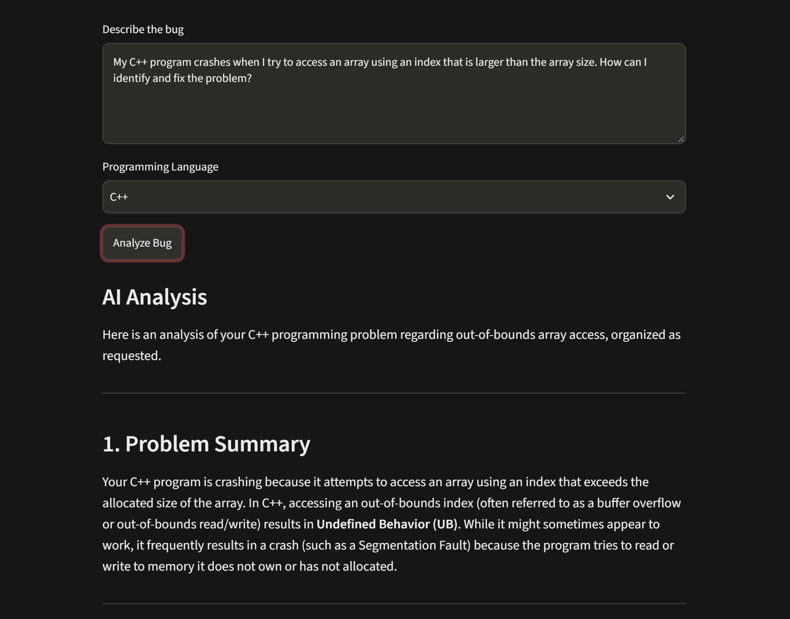
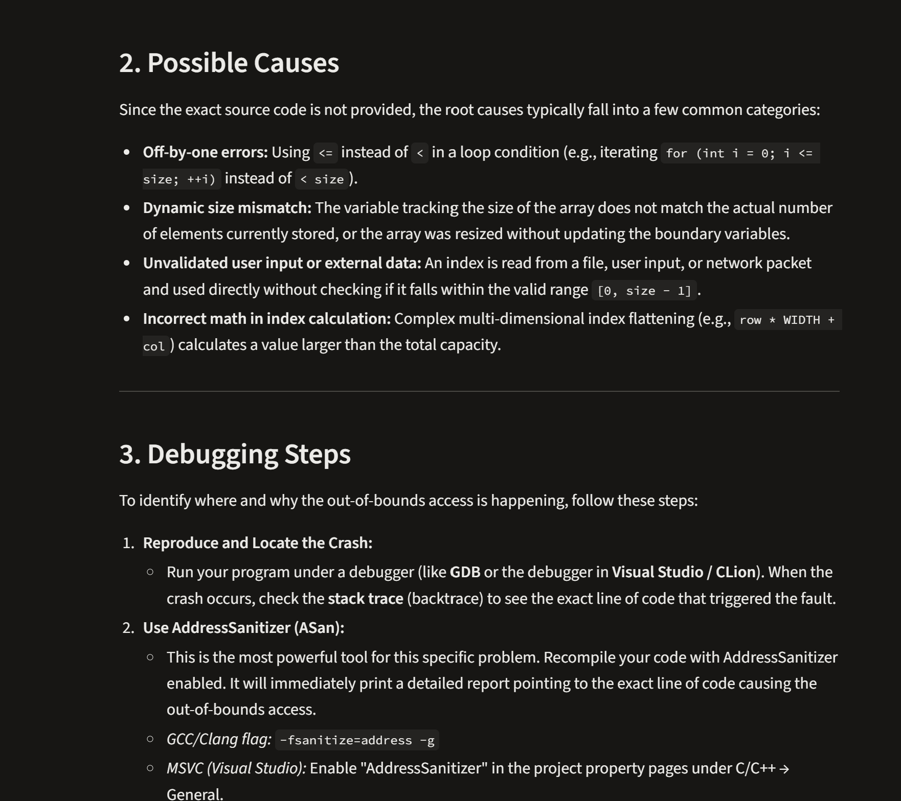

# AI Bug Report Assistant

An AI-powered software debugging assistant developed using Python, Streamlit, and Google's Gemini API.

## 1. Project Overview

The AI Bug Report Assistant is a web-based application designed to help programmers understand and troubleshoot software bugs. Users describe a programming problem, select a programming language, and receive AI-generated explanations, possible causes, debugging steps, and suggested fixes.

The application provides troubleshooting guidance rather than automatically executing or repairing source code.

**Live Application:** https://mrammarhaf-ai-bug-assistant.streamlit.app/

**GitHub Repository:** https://github.com/MrAmmarHaf/AI-Bug-Report-Assistant

## 2. Features

- **Bug Description Input:** Users can enter a bug description containing up to 3,000 characters.
- **Multiple Programming Languages:** Supports C++, Python, Java, JavaScript, and Other.
- **AI-Powered Analysis:** Uses Google Gemini to generate troubleshooting recommendations.
- **Structured Responses:** Organizes results into five sections:
  1. Problem Summary
  2. Possible Causes
  3. Debugging Steps
  4. Suggested Fixes
  5. Additional Information Needed
- **Input Validation:** Prevents empty bug descriptions from being submitted.
- **Error Handling:** Displays a user-friendly message when an API request fails and logs technical error information.
- **Browser-Based Interface:** Accessible through Streamlit.

## 3. Technologies Used

| Technology | Purpose |
|---|---|
| Python | Application programming language |
| Streamlit | Web application framework |
| Google Gemini API | AI-powered debugging analysis |
| Google Gen AI Python SDK | Communication with Gemini |
| GitHub | Version control and source code hosting |
| Streamlit Community Cloud | Web application deployment |

## 4. Installation Instructions

To run the application locally:

**Step 1: Clone the repository**

```bash
git clone https://github.com/MrAmmarHaf/AI-Bug-Report-Assistant.git
```

**Step 2: Navigate to the project directory**

```bash
cd AI-Bug-Report-Assistant
```

**Step 3: Install dependencies**

Ensure Python and pip are installed, then run:

```bash
python -m pip install -r requirements.txt
```

**Step 4: Configure the Gemini API key**

Create a folder named `.streamlit` inside the project directory.

Inside that folder, create a file named `secrets.toml` with the following contents:

```toml
GEMINI_API_KEY = "YOUR_GEMINI_API_KEY"
```

Replace the placeholder with your own Google Gemini API key.

**Important:** Never commit `secrets.toml` or your actual API key to a public GitHub repository. Add `.streamlit/secrets.toml` to your local `.gitignore` file.

**Step 5: Run the application**

```bash
python -m streamlit run app.py
```

Streamlit will provide a local URL where the application can be accessed in a web browser.

## 5. How to Use the Application

1. Open the live application or run it locally.
2. Enter a description of the software bug.
3. Select the programming language.
4. Click **Analyze Bug**.
5. Wait for Gemini to generate the analysis.
6. Review the possible causes, debugging steps, and suggested fixes.
7. Apply and verify any suggested changes in your own development environment.

## 6. Example Use Case

**Programming Language:** C++

**Example Bug Description:**

"My C++ program crashes when I try to access an array using an index that is larger than the array size. How can I identify and fix the problem?"

The application can provide guidance about out-of-bounds array access, possible indexing errors, debugging techniques, and methods for preventing similar issues.

The exact response may vary because the analysis is AI-generated.

## Application Screenshots

### Bug Submission and AI Analysis

The user enters a C++ bug description, selects the programming language, and receives AI-generated debugging guidance.



### Possible Causes and Debugging Steps

The application identifies possible causes and recommends debugging techniques, including debuggers and AddressSanitizer.



## 7. Testing and Validation

The application has been manually tested using programming bug descriptions.

The following behaviors have been reviewed:

- Successful loading of the Streamlit application.
- Submission of a bug description.
- Selection of a programming language.
- Generation and display of an AI response.
- Readable presentation of troubleshooting guidance.

The application also implements validation for empty descriptions and handling for unsuccessful API requests. These safeguards are present in the code but are not claimed here as separately verified test results.

Automated unit testing has not yet been implemented.

## 8. Limitations

- The application cannot automatically compile or execute code.
- It does not directly modify source files.
- It cannot guarantee that the suggested solution is correct.
- The quality of the analysis depends on the information provided by the user.
- An internet connection and access to the Gemini API are required.
- AI service availability and response times may vary.
- The application does not currently store a history of submitted bug reports.

## 9. Project Documentation

Additional documentation is available in this repository:

- [Software Requirements](requirements.md)
- [AI Development Prompt Log](ai-prompt-log.md)

The software requirements document describes the functional requirements, non-functional requirements, scope, assumptions, and development phases.

The AI prompt log documents how AI tools were used during development.

## 10. Future Improvements

Potential improvements include:

- Allowing users to submit source code alongside bug descriptions.
- Adding support for more programming languages.
- Implementing automated unit tests.
- Providing downloadable debugging reports.
- Improving API error handling and user feedback.

## 11. Software Design and Architecture

### 11.1 System Architecture

The AI Bug Report Assistant uses a lightweight web application architecture consisting of a Streamlit user interface, a reusable input-validation module, and an external AI service.

The application is implemented primarily in Python.

**Main Components:**

1. **Streamlit User Interface (`app.py`):** Displays the application interface, collects bug descriptions and programming language selections, sends analysis requests, and presents AI-generated responses.

2. **Input Validation (`validation.py`):** Provides the reusable `is_valid_bug_description()` function, which verifies that the supplied description is a string containing non-whitespace characters.

3. **Google Gemini API:** Processes the submitted bug description and programming language using a structured prompt and generates debugging recommendations.

4. **Streamlit Secrets:** Stores the Gemini API key separately from the application's public source code.

5. **Automated Testing (`test_validation.py`):** Uses Python's `unittest` framework to verify the input-validation function.

6. **GitHub Actions:** Runs the automated validation tests using a GitHub-hosted Python environment.

### 11.2 Application Workflow

The application follows these steps:

1. The user opens the Streamlit application.
2. The user enters a software bug description.
3. The user selects a programming language.
4. The user clicks the Analyze Bug button.
5. The application validates the bug description.
6. If the description is invalid, the application displays a warning and does not request an AI analysis.
7. If the description is valid, the application constructs a structured prompt.
8. The application retrieves the Gemini API key from Streamlit Secrets.
9. The application sends the prompt to Google's Gemini API.
10. Gemini generates debugging recommendations.
11. Streamlit displays the response in a readable format.
12. If the request fails or returns no analysis, the application displays an appropriate message.

### 11.3 Input and Output Design

**Inputs:**

- Bug description: Text input limited to 3,000 characters.
- Programming language: C++, Python, Java, JavaScript, or Other.

**Outputs:**

The application requests AI-generated responses organized into five sections:

1. Problem Summary
2. Possible Causes
3. Debugging Steps
4. Suggested Fixes
5. Additional Information Needed

The generated content is displayed using Streamlit's Markdown rendering.

### 11.4 Error Handling Design

The application uses input validation and exception handling to reduce unexpected failures.

- Empty and whitespace-only descriptions are rejected.
- Missing Gemini API keys produce a user-facing configuration message.
- Missing Streamlit secrets configurations are handled through exception handling.
- Failed Gemini API requests produce a general error message.
- Technical exception information is printed to the application logs.
- Empty Gemini responses produce a warning.

### 11.5 Security Considerations

The Gemini API key is retrieved from Streamlit Secrets rather than embedded directly in the application source code.

The application does not currently implement user authentication or persistent storage of bug reports.

User-provided descriptions are sent to Google's Gemini API for processing. Users should avoid submitting passwords, API keys, or other confidential information.

### 11.6 Design Limitations

The current architecture is designed for a small, text-based debugging assistant.

It does not provide source code execution, automatic repairs, direct IDE integration, persistent conversation history, or a database.

The AI model may generate incorrect or incomplete recommendations. Users are responsible for verifying suggested fixes.

### 11.7 Future Design Improvements

Potential future improvements include separating Gemini communication into its own Python module, introducing automated API error-handling tests, adding source code upload functionality, and providing downloadable debugging reports.
